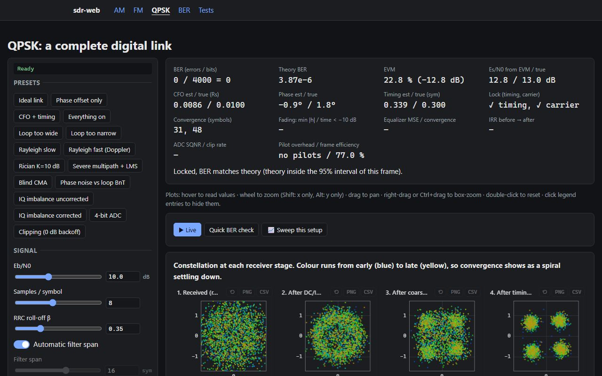
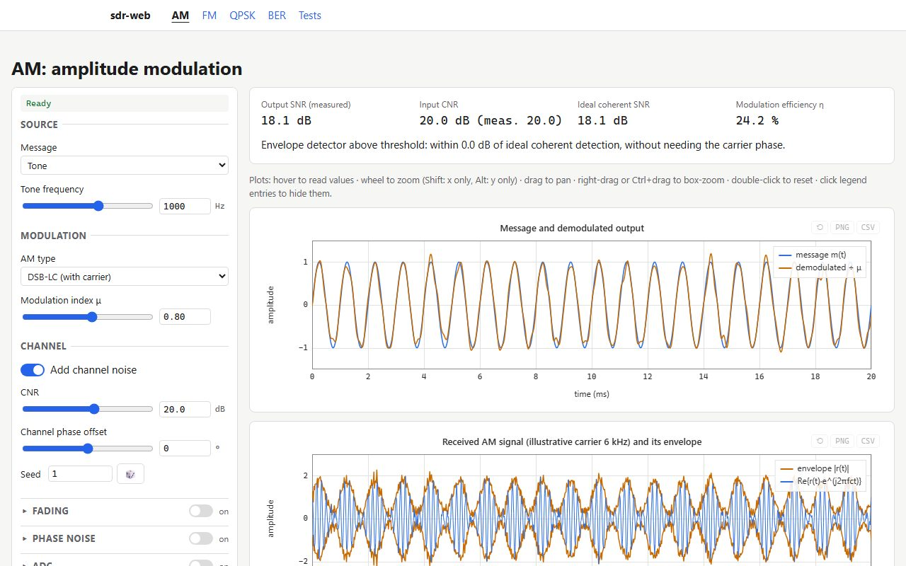
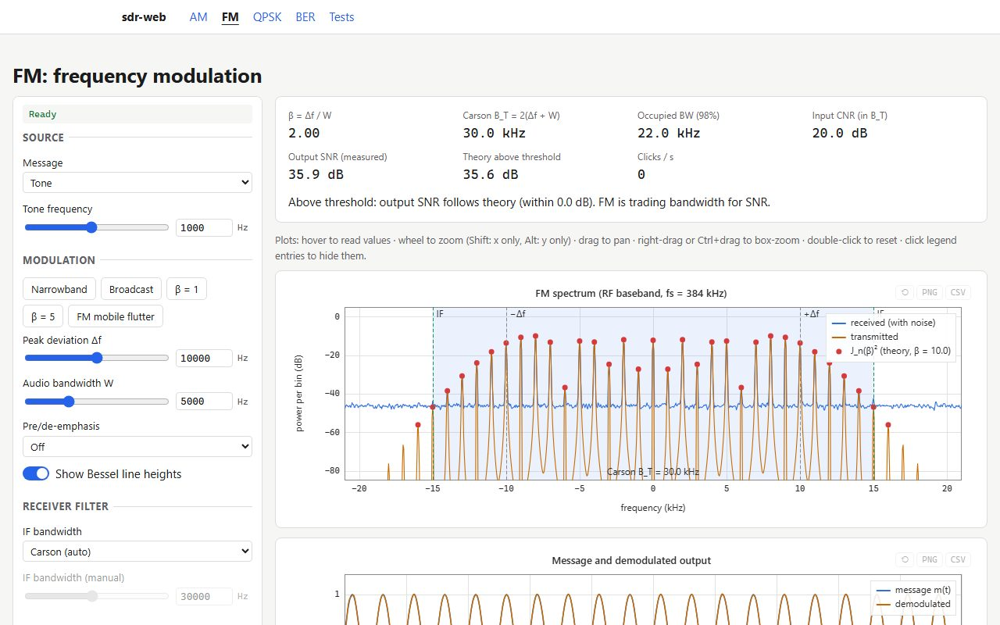
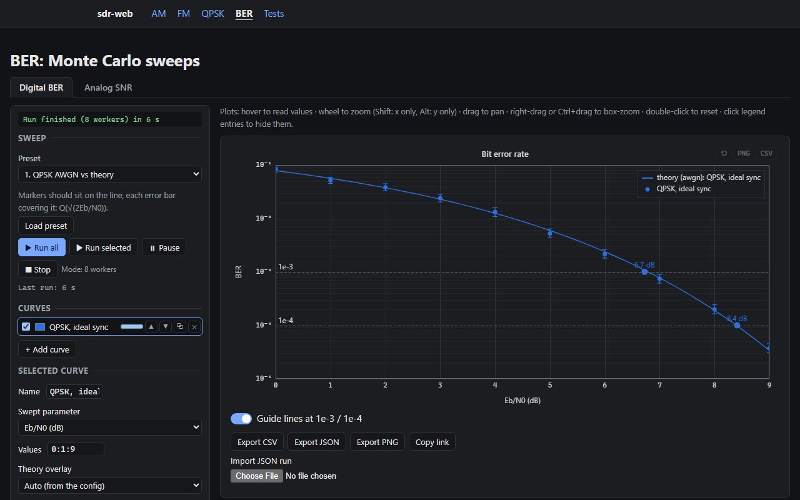
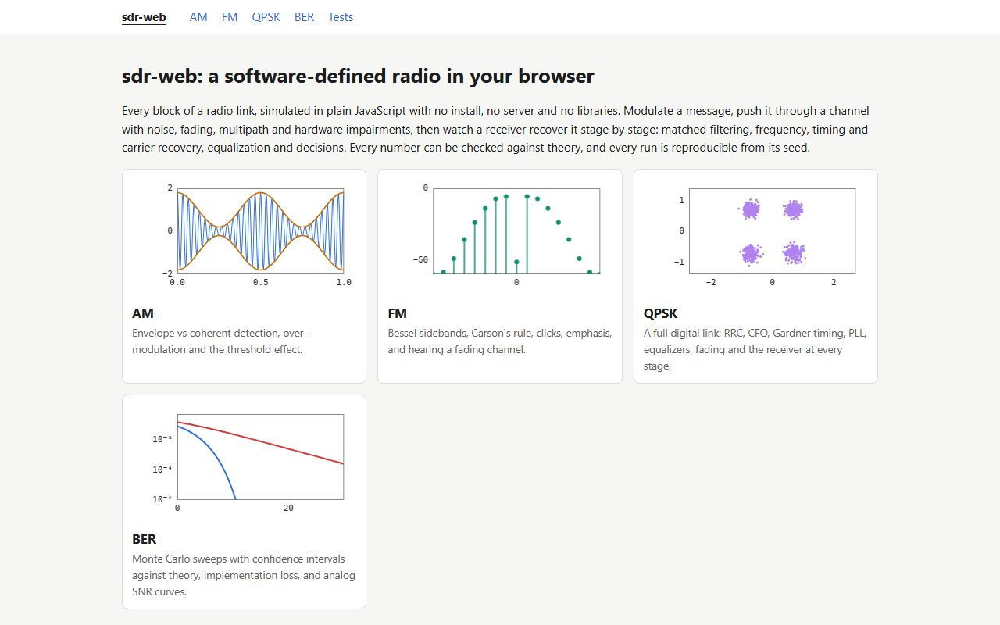

# sdr-web

[](https://github.com/Hopexist/sdr-web/actions/workflows/tests.yml)

A software-defined radio simulator that runs entirely in the browser: AM, FM and a full QPSK link, a channel with
noise, fading, multipath and hardware impairments, and Monte Carlo BER curves checked against theory.
Plain HTML, CSS and JavaScript, with no install and no libraries.

**Live site:** _coming soon (GitHub Pages)_ <!-- TODO: replace with the Pages URL once it is live -->



## What's in it

| Page | What you can do |
|---|---|
| **AM** | Tone, two-tone, chirp or your own audio file; DSB-LC / DSB-SC; envelope vs coherent detection; hear the result; output SNR vs CNR with theory. |
| **FM** | Set Δf and W and watch Carson's band and the Bessel sidebands J_n(β)²; discriminator or PLL demodulator; 75 µs emphasis; push the CNR down and *hear* the threshold clicks. |
| **QPSK** | A complete digital receiver: RRC matched filter, 4th-power CFO estimate, Gardner timing with a Farrow interpolator, decision-directed PLL, equalizers (NLMS, CMA, zero-forcing), preamble/pilot channel estimates, frame sync. Every stage can be **Real** or **Ideal**, and you see the constellation after each one. |
| **BER** | Sweep any parameter (Eb/N0, ADC bits, loop bandwidth, Doppler…), watch points land on the theory curve with 95% confidence intervals, read off implementation loss, export CSV/JSON/PNG. Runs in a Web Worker pool when served over http. |
| **Tests** | 221 checks run in your browser: DSP building blocks, noise scaling, noiseless loopbacks, sync loops locking, BER inside its confidence interval of theory. |

Every run is reproducible from its seed, and "Copy link" puts the whole setup in the URL.
Keyboard: `Space` run/play, `R` reset, `L` copy link, `T` theme, `?` for the list.

| AM | FM |
|---|---|
|  |  |
| **BER** | **Landing page** |
|  |  |

## Verified against theory

Numbers measured with the simulator itself (BER page presets and `tests.html`); every row is reproducible from its seed.

| Check | Simulated | Theory / reference |
|---|---|---|
| QPSK in AWGN, ideal sync: loss at BER 1e-3 / 1e-4 | −0.01 dB / −0.09 dB | 0 dB (Q(√(2Eb/N0))) |
| QPSK, full real sync chain: loss at 1e-3 / 1e-4 | 0.10 dB / 0.14 dB | small, > 0 (loop jitter) |
| Rayleigh fading: diversity slope | 0.98 decades/decade | 1 (0.999 over the same range) |
| Rician K = 10 dB, BER at the test point | 6.98e-4 | 7.01e-4 |
| Pilot-aided channel estimate vs ideal CSI (Rayleigh) | 1.07 dB worse | expected: estimation noise |
| Severe multipath + NLMS equalizer: loss | 0.53 dB | — |
| IQ imbalance correction: image rejection | 22.8 dB → 52.6 dB | — |
| ADC SQNR at 4 / 8 / 12 bits | within 0.4 dB | 6.02·b + 1.76 − backoff |
| Coarse CFO estimate error | ≈ 2e-7 × Rs | — |
| FM output SNR above threshold | 40.8 dB | 40.6 dB (3β²(β+1)·CNR) |
| FM carrier null at β = 2.4048 | J0 ≈ 1e-16 | J0(2.4048) = 0 |
| FM threshold | 0 clicks/s at 10 dB CNR, 12/s at 8 dB | ≈ 10 dB |
| Jakes fading autocorrelation | ≈ J0(2π·fd·τ) | J0(2π·fd·τ) |

Preset run times, main thread on file:// vs 8 workers over http (same results, same seeds):
preset 1 11.0 → 6.3 s, preset 2 13.1 → 6.5 s, preset 4 25.3 → 8.8 s, preset 5 29.1 → 5.6 s, preset 6 5.0 → 1.1 s.

## Run it

- **No install:** double-click `index.html`. Everything works from `file://`; BER sweeps run on the main thread.
- **Faster sweeps:** serve the folder so the BER page can use Web Workers:
  ```
  python -m http.server 8000
  ```
  then open <http://localhost:8000>.

## Tests

Open `tests.html`. The banner should read **PASS 221 / 221**; the plots below it are demos to check by eye.

CI runs the same page on every push: [.github/workflows/tests.yml](.github/workflows/tests.yml) serves the site,
drives headless Chrome over the DevTools protocol ([ci/run-browser-tests.mjs](ci/run-browser-tests.mjs), no npm),
waits for `PASS`, then loads every page and fails on any error.

## How it's built

- One global namespace (`window.SDR`) and classic `<script>` tags in dependency order, because Chrome blocks ES
  modules and workers on `file://`.
- All DSP is DOM-free and takes a seeded `rng`, so the same code runs on the page, in a Web Worker and in tests.
- Complex signals are `{ re: Float64Array, im: Float64Array }`; symbols have Es = 1, RRC pulses unit energy, and
  AWGN has variance N0 = 1/(Es/N0) per sample.
- Every filter, loop and equalizer is a streaming block (`create` → `process(block)` → `reset`); the QPSK link is
  `createLink(cfg, rng)` → `step(n)` → `finish()`, run in small time slices so the page never freezes.
- The FFT, filters, plots, PRNG and erfc are all written from scratch.

Details, diagrams and the reasoning behind the channel and receiver order: [docs/ARCHITECTURE.md](docs/ARCHITECTURE.md).
History: [CHANGELOG.md](CHANGELOG.md).

## What I learned

<!-- DRAFT: edit -->
- **Noise scaling is a convention, and it has to be written down once.** Eb/N0, Es/N0 and per-sample SNR differ by
  10·log10(2) and 10·log10(sps). Fixing Es = 1 and unit-energy pulses made the AWGN variance a one-liner, and a test
  of measured SNR caught every mistake before a BER curve did.

<!-- DRAFT: edit -->
- **The matched filter is where the SNR comes from.** Pulse shaping and matched filtering with the same RRC gives
  a Nyquist pulse with zero ISI at the right sampling instant, and the per-sample SNR, which is low, becomes Es/N0 at
  the symbol strobe.

<!-- DRAFT: edit -->
- **Loop bandwidth is a trade-off you can see.** A wide carrier loop locks fast but lets noise in as phase jitter; a
  narrow one is clean but slow and loses lock under phase noise. The "Loop too wide / too narrow" presets and the
  phase-noise sweep show the optimum moving with the linewidth.

<!-- DRAFT: edit -->
- **Cycle slips are why the preamble matters.** QPSK has a 90° ambiguity, and a PLL that slips a quarter turn
  rotates every following decision. Resolving the ambiguity on a known preamble (or using differential coding) is
  what keeps the BER from jumping to 0.5 for the rest of a frame.

<!-- DRAFT: edit -->
- **Clipping barely hurts QPSK.** All four points have the same amplitude and the information is in the signs of
  I and Q, so clipping the peaks at 0 dB backoff costs much less than its SQNR suggests. A multi-level constellation
  like 16-QAM would not be so forgiving.

<!-- DRAFT: edit -->
- **Equalizers can't fix spectral nulls.** A zero-forcing equalizer inverts the channel, so a deep null becomes huge
  noise gain; LMS/MMSE backs off instead. The equalizer's response plot shows it.

<!-- DRAFT: edit -->
- **Streaming DSP is mostly about state.** Moving from whole-signal to block processing meant every filter, loop and
  interpolator had to carry its history across block edges. A bit-exactness test against the old batch receiver at
  odd block sizes (64, 257, 4096) found every off-by-one.

## Limitations and future work

- Only QPSK: 8-PSK and 16-QAM (with theory curves) are next.
- No channel coding: a rate-1/2 convolutional code with hard- and soft-decision Viterbi would show coding gain.
- No OFDM (cyclic prefix, per-subcarrier equalization).
- Floating point only: a fixed-point receiver (quantized matched filter and PLL, BER vs word length) would bridge to
  FPGA/ASIC work.
- Simulated signals only: loading real IQ recordings (`.wav` IQ or `.cu8`) is not supported yet.
- BER points stopped by the per-point time limit depend on machine speed; points stopped by error or bit counts are
  exactly reproducible.
