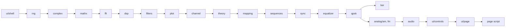
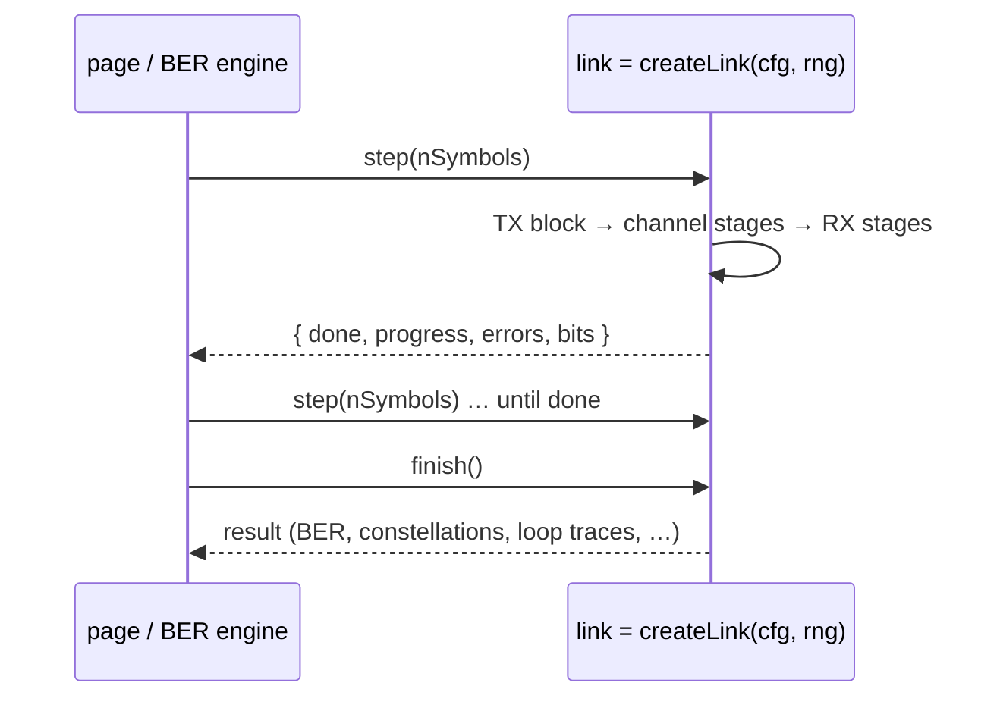

# Architecture

How sdr-web is put together, and why. This is for someone about to read or change the code.

## Folder map

```
index.html  am.html  fm.html  qpsk.html  ber.html  tests.html  404.html
css/style.css                 one stylesheet: light/dark tokens, layout, controls, overlays
js/
  core/                       pure DSP, no DOM (except plot.js)
    rng.js       SDR.rng      seeded PRNG (xoshiro128**, mulberry32), randn, randnComplex, randomBits
    complex.js   SDR.cx       {re, im} array arithmetic, power, rotate, mixFreq
    mathx.js     SDR.mathx    erfc, Q, dB conversions, Bessel J_n
    fft.js       SDR.fft      radix-2 FFT/IFFT
    dsp.js       SDR.dsp      convolve, windows, Welch PSD, occupied bandwidth, output-SNR measurement
    filters.js   SDR.filters  RRC, Kaiser lowpass, FIR (batch + streaming), resampler, DC blocker
    plot.js      SDR.plot     interactive Canvas 2D plots (the one DOM file in core/)
  channel.js     SDR.channel  impairments as streaming stages
  theory.js      SDR.theory   closed-form BER/SNR, Wilson intervals, quantiles
  analog/am.js   SDR.am       AM modulate / envelope + coherent demod
  analog/fm.js   SDR.fm       FM transmit / receive, discriminator, PLL demod, emphasis, clicks
  digital/
    mapping.js   SDR.mapping  Gray QPSK map / demap, differential coding
    sequences.js SDR.seq      m-sequences, preamble
    sync.js      SDR.sync     PLL, loop gains, Gardner + Farrow timing loop, 4th-power CFO, lock detection
    equalizer.js SDR.eq       NLMS (T, T/2), CMA, zero-forcing
    qpsk.js      SDR.qpsk     frame builder, streaming link createLink → step / finish
  ber.js         SDR.ber      Monte Carlo sweep engine, stop rules, seeds, worker pool
  ber-worker.js               classic Web Worker running one sweep point (http(s) only)
  audio.js       SDR.audio    Web Audio load / play
  tests.js                    the in-browser test suite
  ui/                         DOM code: one script per page + shared pieces
    shell.js     SDR.shell    error banner, theme, shortcuts, tour, footer (loaded first on every page)
    controls.js  SDR.ui       sliders, selects, toggles, URL-hash state, runChunked
    page.js      SDR.page     the simulator-page scaffold (panel, readouts, plot cards, audio, sweeps)
    qpsk-controls.js          QPSK controls shared by the QPSK page and the BER curve editor
    am-page.js  fm-page.js  qpsk-page.js  ber-page.js  index-page.js
ci/run-browser-tests.mjs      headless-Chrome CI runner (DevTools protocol, no npm)
ci/screenshots.mjs            regenerates docs/img
```

## One namespace, classic scripts, fixed load order

The site must work when `index.html` is double-clicked. Chrome blocks ES modules and Web Workers on `file://`,
so every file is a classic `<script src>` that attaches to one global:

```js
(function () {
  'use strict';
  var SDR = (window.SDR = window.SDR || {});
  SDR.fft = { fft: fft, ifft: ifft, fftshift: fftshift };
})();
```

Files only look up their dependencies when a function runs, but the pages still load them in dependency order:



`shell.js` comes first so its error banner catches errors from everything after it. Web Workers
(`ber-worker.js`) are an optional speed-up: they are used only over http(s), and the BER page falls back to
the main thread on `file://`.

## The DOM-free rule

`js/core`, `js/channel.js`, `js/theory.js`, `js/analog`, `js/digital` and `js/ber.js` never touch the DOM.
They are pure functions of their inputs and an `rng`. That is what lets the same code run on the page, inside
a Web Worker (`self.window = self` is the only shim) and in Node for quick experiments. `plot.js` is the one
exception in `core/`: every page needs it, and drawing is its job. Only `js/ui/*` reads controls and draws.

## Streaming blocks

Every stateful DSP element is an object that carries its own history between blocks:

```js
var fir = SDR.filters.createFir(taps);   // create(config)
var y1 = fir.process(block1);            // process(block) → block of the same rate (or resampled)
var y2 = fir.process(block2);            // continues exactly where block1 stopped
fir.reset();                             // back to the initial state
```

Filters, the up-sampling pulse shaper, the resampler, DC blocker, timing loop, PLL, equalizer and every channel
stage follow this pattern. `SDR.qpsk.createLink(cfg, rng)` wires them into one link:



`runLink` is just a loop over `step()`. Pages and the BER engine call `step()` inside `SDR.ui.runChunked`, a
time-budgeted generator runner, so no slice of work blocks the page for more than ~20 ms. The test suite checks
that the streaming link is bit-exact with the old whole-signal receiver (`runLinkBatch`, kept only for that test)
for block sizes 64, 257 and 4096.

## The QPSK link

```mermaid
flowchart LR
  bits --> map[Gray map, Es = 1] --> frame[lead-in · preamble · payload · pilots]
  frame --> rrc[RRC pulse shaping]
  rrc --> ch
  subgraph ch [channel]
    direction LR
    mp[multipath] --> fad[fading] --> tim[timing / drift] --> cfo[CFO] --> pn[phase noise] --> ph[phase] --> awgn[AWGN] --> iq[IQ imbalance] --> dc[DC] --> adc[ADC]
  end
  ch --> rx
  subgraph rx [receiver]
    direction LR
    dcb[DC blocker] --> iqc[IQ correction] --> mf[matched filter] --> ccfo[4th-power CFO] --> gard[Gardner + Farrow] --> eq[equalizer] --> pll[PLL / channel estimate] --> fs[frame sync] --> dec[decisions]
  end
```



**Channel order, and why:**
- Multipath and fading first: they are the propagation path.
- Timing offset / clock drift and CFO next: they belong to the receiver's oscillators, which see the faded signal.
- Phase noise and static phase: the local oscillator again.
- AWGN after the propagation and oscillator effects: thermal noise enters at the receiver front end.
- IQ imbalance, DC offset and ADC last: they are the receiver's analog hardware and converter, so they act on
  signal plus noise.

**Receiver order, and why:** the DC blocker and IQ correction undo front-end errors before anything relies on a clean
constellation; the matched filter maximizes SNR; the coarse CFO estimate (4th power removes the QPSK modulation) must
come before timing because a large frequency offset smears the Gardner detector; the equalizer needs
symbol-synchronous samples, so it follows timing; and the decision-directed PLL needs ISI-free symbols, so it follows
the equalizer. With LMS or a preamble/pilot channel estimate, the frame is found first on the timing output so the
equalizer can train on the known preamble.

## Conventions

| Convention | Rule | Where it is tested |
|---|---|---|
| Complex signals | `{ re: Float64Array, im: Float64Array }` at sample rate `fs` | everywhere |
| Symbol energy | QPSK points (±1 ± j)/√2, so Es = 1 | "Es ≈ 1" |
| Pulse energy | RRC taps normalized so Σg² = 1 | "unit-energy RRC" |
| Noise scaling | complex AWGN per sample with variance N0 = 1/(Es/N0), N0/2 per axis; Es/N0 = Eb/N0 + 10·log10(2) | "measured SNR ≈ requested", AWGN BER vs theory |
| Per-sample SNR | SNR = Es/N0 − 10·log10(sps), written once as `SDR.channel.snrPerSampleDb` | conversion test |
| Filter delay | every filter returns its group delay; receivers trim it | noiseless loopback = 0 errors |
| Seeds | every random function takes an `rng`; sweep point i uses `deriveSeed(seed, i)`; stages that need their own randomness get a sub-generator only when enabled | reproducibility tests, main thread vs worker equality |
| dB | `db2lin`/`lin2db` amplitude (20·log10), `db2pow`/`pow2db` power (10·log10) | mathx tests |

## Tests and CI

`tests.html` runs `js/tests.js` in the browser (221 checks) and writes `PASS n/n` into `<pre id="ci-result">`.
`.github/workflows/tests.yml` serves the folder with `python3 -m http.server`, then `ci/run-browser-tests.mjs`
drives the preinstalled headless Chrome over the DevTools protocol: it waits for `PASS`, then loads every page and
fails on any uncaught exception, console error, or the `data-error` attribute the error banner sets.
